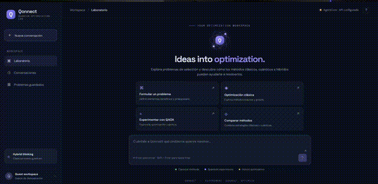
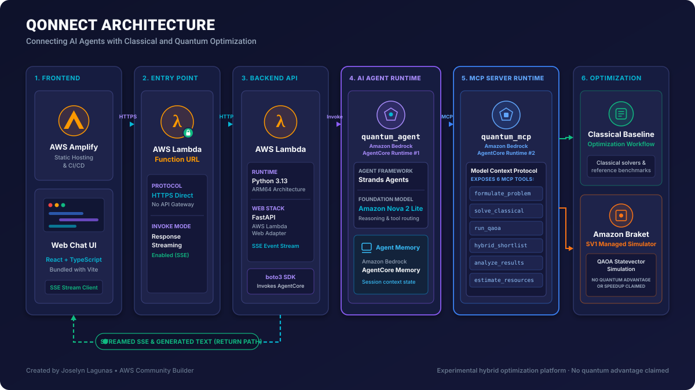
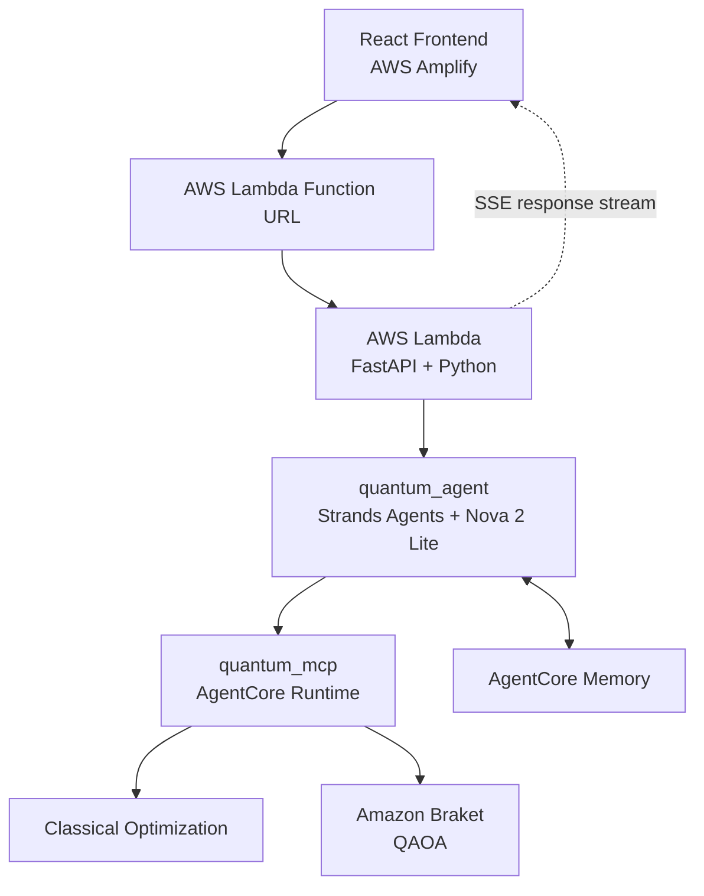

# ⚛️ Qonnect

<h3 align="center">Connecting AI Agents with Classical & Quantum Optimization through MCP\</h3>

<p align="center">
&#x20; An experimental platform exploring how AI agents can orchestrate classical and quantum optimization tools through the Model Context Protocol.
</p>

<p align="center">
&#x20; \
&#x20; \
&#x20; \
&#x20; \
&#x20; \</p>

<p align="center">
&#x20; <strong>Created by <a href="[https://www.linkedin.com/in/joselyn-lagunas/](https://www.linkedin.com/in/joselyn-lagunas/)">Joselyn Lagunas</a></strong>
</p>

---

## ✨ See Qonnect in action

<!-- Replace with your actual demo GIF -->

<div align="center">
  
</div>

<p align="center">
&#x20; <em>From natural language requests to coordinated optimization workflows.</em>
</p>

---

## 💡 What is Qonnect?

What if an AI agent could access quantum computing tools to experiment with optimization problems?

**Qonnect explores this idea.**

It connects an AI agent to a dedicated MCP server that exposes classical and quantum optimization capabilities. Through a conversational interface, users can describe a problem, request a solution, estimate resources, and analyze results.

The goal is to make emerging optimization technologies accessible through agentic AI.

## 🏗️ Architecture

<p align="center">
&#x20; 
</p>

### How it works



### Architecture components

| Component           | Responsibility                                             |
| ------------------- | ---------------------------------------------------------- |
| **Frontend**        | React + TypeScript conversational interface                |
| **API Entry Point** | AWS Lambda Function URL                                    |
| **Backend**         | FastAPI running on AWS Lambda                              |
| **AI Agent**        | Strands Agents on Amazon Bedrock AgentCore Runtime         |
| **MCP Server**      | Independent AgentCore Runtime exposing optimization tools  |
| **Optimization**    | Classical solving and experimental QAOA with Amazon Braket |
| **Memory**          | AgentCore Memory for contextual continuity                 |

The agent and MCP server run in separate AgentCore runtimes. The backend streams tool activity and generated responses to the frontend using Server-Sent Events (SSE).

---

## 🔌 MCP Tools

Qonnect exposes six tools that allow the agent to interact with the optimization environment.

| Tool                 | Capability                                 |
| -------------------- | ------------------------------------------ |
| `formulate_problem`  | Formulates an optimization problem         |
| `solve_classical`    | Executes a classical optimization approach |
| `run_qaoa`           | Runs an experimental QAOA workflow         |
| `hybrid_shortlist`   | Supports hybrid optimization workflows     |
| `analyze_results`    | Analyzes optimization results              |
| `estimate_resources` | Estimates required computational resources |

**Why MCP?**

Instead of embedding optimization logic directly into the agent, Qonnect uses MCP as a standardized interface between reasoning and execution.

This modular approach makes it possible to extend the system with additional tools and optimization strategies.

---

## 🧰 Technology Stack

<p align="center">
&#x20; 
</p>

| Layer                   | Technologies                       |
| ----------------------- | ---------------------------------- |
| Agentic AI              | Strands Agents, Amazon Nova 2 Lite |
| Tool integration        | Model Context Protocol             |
| Cloud infrastructure    | AWS Lambda, AWS Amplify            |
| Agent infrastructure    | Amazon Bedrock AgentCore           |
| Quantum experimentation | Amazon Braket                      |
| Backend                 | Python 3.13, FastAPI               |
| Frontend                | React, TypeScript, Vite            |
| Streaming               | Server-Sent Events                 |

---

## 📂 Project Structure

```text
qonnect/
├── app/
│   ├── chat_backend/   # API and Lambda integration
│   ├── quantum_agent/  # Strands AI agent
│   └── quantum_mcp/    # MCP server and optimization tools
│
├── web/                # React + TypeScript frontend
│
├── assets/
│   ├── qonnect-demo.gif
│   └── qonnect-architecture.svg
│
└── README.md
```

---

## 🚧 Project Status

<kbd>Working end-to-end experimental demo</kbd>

- [x] Conversational frontend deployed on AWS Amplify
- [x] Lambda Function URL integration
- [x] FastAPI backend on AWS Lambda
- [x] Strands agent on AgentCore Runtime
- [x] Independent MCP server on AgentCore Runtime
- [x] Six MCP optimization tools
- [x] Classical optimization workflow
- [x] Experimental QAOA integration with Amazon Braket
- [x] AgentCore Memory integration
- [x] SSE streaming between backend and frontend
- [ ] Further testing, evaluation, and optimization

> **Research note:** Qonnect is an experimental project. It does not claim quantum advantage or speedup. Its purpose is to explore how classical and quantum optimization approaches can be orchestrated and evaluated through AI agents.

---

## 🔭 Vision

Qonnect explores the intersection of three areas:

- **Agentic AI:** agents that can reason, select tools, and coordinate workflows.
- **Cloud computing:** infrastructure that makes emerging technologies accessible.
- **Quantum computing:** experimentation with optimization approaches and quantum resources.

Rather than replacing classical computing, the project explores how AI agents can help users work with different computational approaches and understand when each might be useful.

---

## 👩‍💻 Author

**Joselyn Lagunas**

AWS Community Builder · Agentic AI · Cloud Computing · Emerging Technologies

[LinkedIn](https://www.linkedin.com/in/joselyn-lagunas/)

---

<p align="center">
&#x20; <strong>Qonnect</strong><br>
&#x20; <em>Connecting ideas, agents, and emerging computational technologies.</em>
</p>
